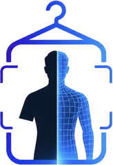
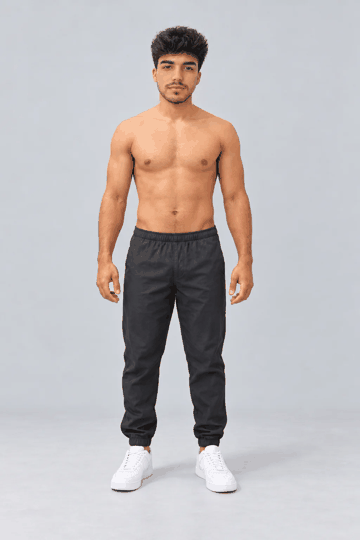
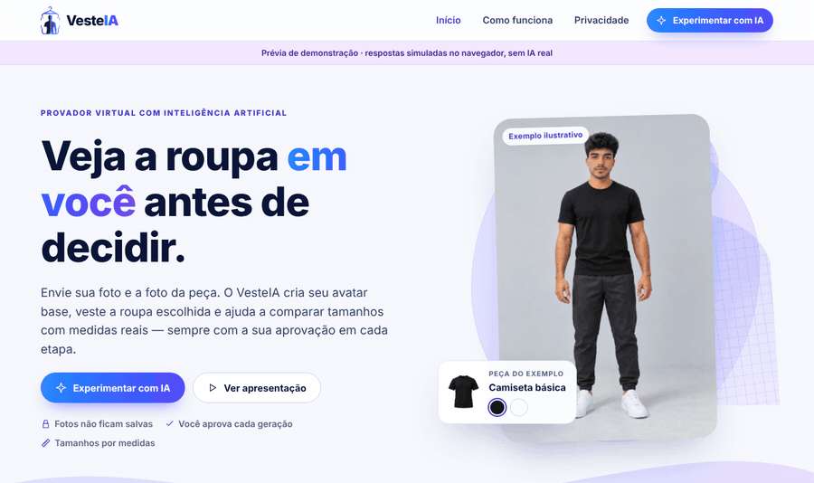
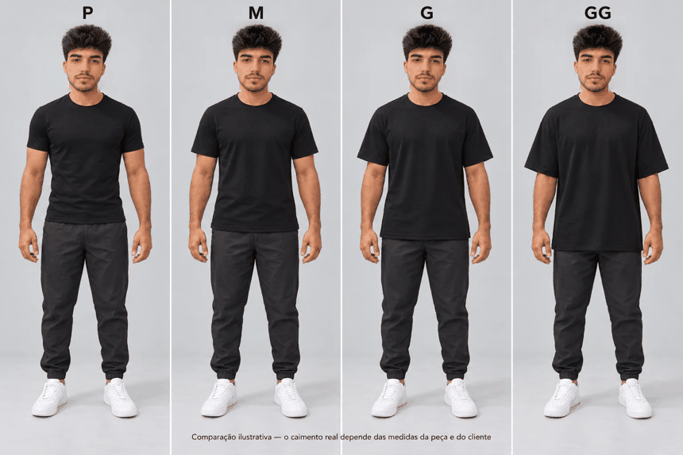

<div align="center">




<a href="#-como-funciona">
  
</a>

<br/>


**[Como funciona](#-como-funciona) · [Demonstração](#-demonstração) · [Tamanhos](#-tamanho-é-medida-não-etiqueta) · [Tecnologias](#-tecnologias) · [Rodar localmente](#-rodar-localmente)**

</div>

---

## ✨ O que é

O **VesteIA** é um provador virtual para e-commerce de moda. A pessoa envia uma foto — selfie, meio corpo ou corpo inteiro — e a foto da roupa. A IA cria um **avatar base** com a aparência dela, **veste a peça escolhida** e ajuda a **comparar tamanhos usando medidas reais**, com aprovação em cada etapa.

> 🎯 **Objetivo:** dar confiança na compra online e reduzir devoluções por tamanho errado.

<div align="center">
  
  <br/>
  <sub>Avatar base → com a peça escolhida · <i>exemplo ilustrativo</i></sub>
</div>

## 🧭 Como funciona

<table>
  <tr>
    <td align="center" width="16%"><h3>📸</h3><b>1. Sua foto</b><br/><sub>Selfie, meio corpo ou corpo inteiro</sub></td>
    <td align="center" width="16%"><h3>👕</h3><b>2. Peças</b><br/><sub>Uma ou mais fotos de roupa</sub></td>
    <td align="center" width="16%"><h3>📏</h3><b>3. Categoria</b><br/><sub>Tipo, tamanho e medidas</sub></td>
    <td align="center" width="16%"><h3>🧑</h3><b>4. Avatar base</b><br/><sub>Gerado e aprovado por você</sub></td>
    <td align="center" width="16%"><h3>🪄</h3><b>5. Vestir</b><br/><sub>A peça substitui a da mesma região</sub></td>
    <td align="center" width="16%"><h3>⚖️</h3><b>6. Comparar</b><br/><sub>Antes e depois, look e tamanhos</sub></td>
  </tr>
</table>

## 🎬 Demonstração

<div align="center">
  
  <br/>
  <sub>Fluxo completo em <b>modo de teste</b>, com respostas simuladas (sem custo). Com a OpenAI ativa, as imagens são geradas pela IA.</sub>
</div>

## 📐 Tamanho é medida, não etiqueta

<div align="center">
  
</div>

**P nem sempre é justo e GG nem sempre é oversized.** O VesteIA calcula a folga de cada tamanho a partir das medidas da peça — largura, comprimento, mangas, cintura, quadril e entrepernas — e, se a pessoa informar, das medidas dela. Quando falta uma medida, avisa. Nunca inventa centímetros a partir da imagem.

## 🚀 Destaques

| | |
|---|---|
| 🗄️ **Sem banco obrigatório** | O provador roda só com o backend FastAPI. |
| 🔌 **IA plugável** | Interface única: OpenAI `gpt-image-2`, CatVTON local, Google Vertex ou modo simulado. |
| 💰 **Custo sob controle** | Geração só por clique, contagem antes de cada ação, bloqueio de clique duplicado e limites diários que persistem. |
| 🔒 **Privacidade** | Consentimento antes de processar, fotos só em memória, botão para limpar a sessão e chaves apenas no backend. |
| ♿ **Acessível** | Teclado, contraste, movimento reduzido e layout para celular. |

## 🛠️ Tecnologias

<div align="center">
  
</div>

| Camada | Tecnologias |
|---|---|
| Frontend | React 19, Vite, CSS próprio |
| Backend | Python 3.12, FastAPI, Pillow |
| IA | OpenAI Images API (`gpt-image-2`), CatVTON, Google Vertex AI |
| Testes | unittest/pytest, Playwright |
| Legado (opcional) | PostgreSQL, MediaPipe, OpenCV |

## 💻 Rodar localmente

<details>
<summary><b>Windows · passo a passo</b></summary>

```powershell
# Backend
cd backend
copy .env.example .env          # AVATAR_PROVIDER=mock e TRYON_PROVIDER=mock para testar sem custo
py -3.12 -m venv .venv312
.\.venv312\Scripts\python.exe -m pip install -r requirements.txt
.\.venv312\Scripts\python.exe -m uvicorn app.main:app --host 127.0.0.1 --port 8000
```

```powershell
# Frontend (outro terminal)
cd frontend
npm install
npm run dev -- --host 127.0.0.1 --port 5173
```

Abra **http://127.0.0.1:5173**. Atalhos: `INICIAR_BACKEND.bat` e `INICIAR_FRONTEND.bat`.

</details>

## 📚 Documentação

- [LEIA_PRIMEIRO.md](LEIA_PRIMEIRO.md) — instalação passo a passo
- [docs/PROVADOR_2_0.md](docs/PROVADOR_2_0.md) — arquitetura, provedores de IA, custos, privacidade e deploy
- [docs/RELATORIO_TESTES_2_0.md](docs/RELATORIO_TESTES_2_0.md) — testes e limitações conhecidas

## 📍 Status

🚧 **MVP em desenvolvimento.** O fluxo completo funciona com respostas simuladas; a integração com a OpenAI está pronta e aguarda o teste controlado com créditos de API. As imagens de exemplo são ilustrativas.

## 👤 Fundador

<table>
  <tr>
    <td></td>
    <td><b>João Gabriel Lucena</b><br/><a href="https://github.com/jaocoding1910">@jaocoding1910</a></td>
  </tr>
</table>

<div align="center">


</div>
